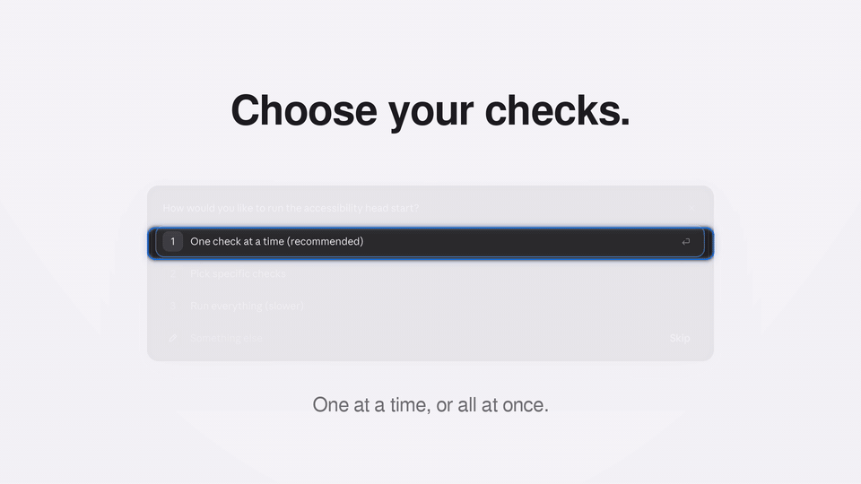
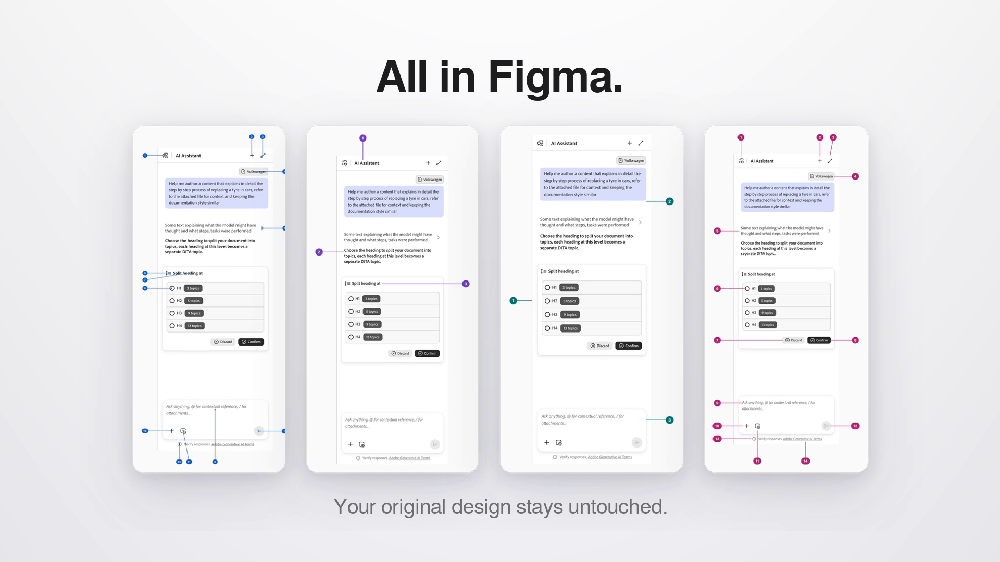

# a11y-audit

**Your accessibility head start, right in Figma.**

`a11y-audit` is a [AI skill](https://support.claude.com/en/articles/12512180-use-skills-in-claude) that drafts Blueline accessibility annotations for a UI design. Give it a Figma frame link (or a screenshot) and it writes suggested accessible names, heading levels, landmarks and focus order into a new review page in the same file. Each check gets its own section, ready to review and carry into Stark.



▶ [Watch the 48-second launch film](media/a11y-audit-launch-film.mp4)

---

## What it does

- **Suggests, rather than grades.** Every card leads with the answer — `Accessible name: "Send"`, `Heading level: H2`, `Tab stop 6: "Split heading at" radio group` — then says why it helps, then lists the WCAG 2.2 AA criterion, JIRA tag and confidence. No pass/fail score, no "you missed this".
- **You choose what to run.** One check at a time (recommended), pick specific checks, or run everything.
- **One section per check**, on a single review page:

  | Blueline annotations | Design suggestions |
  |---|---|
  | Accessible names · Headings · Landmarks · Focus order | Color & contrast · Touch targets · Text & links · Forms & errors |

  Each section has its own copy of the screen, numbered callouts with leader lines in the margin (never over the UI), and a column of suggestion cards. Anything a static design can't show (keyboard behaviour, zoom, motion) is listed as "For dev & QA".
- **Makes the call.** One concrete suggestion per element, with an honest confidence rating, instead of a list of options.
- **Never touches your design.** The original frame is read-only for the whole run; everything is written to a new page.
- **Built on** Adobe's Design Accessibility Checklist (WCAG 2.2 AA), Blueline/Stark annotation conventions, and accessible-name computation (AccName).



## Requirements

- **Claude** with skills and code execution enabled.
- **The Figma connector (MCP)** with write access, plus Figma's companion skills `figma-use` and `figma-design-to-code`, which the skill loads before Figma calls. The Figma file should be open in the Figma desktop app while the skill runs.

## Install

### Claude (web, desktop, mobile)

1. Download [`dist/a11y-audit.zip`](dist/a11y-audit.zip) (the same file is also provided as `a11y-audit.skill`). It contains the `a11y-audit/` skill folder.
2. Make sure code execution is turned on in **Settings → Capabilities**.
3. Upload it as a custom skill. The current steps are in [Use skills in Claude](https://support.claude.com/en/articles/12512180-use-skills-in-claude).

### Claude Code

Copy the skill folder into your skills directory:

```bash
git clone https://github.com/rahul-agarwal-08/a11y-audit.git
mkdir -p ~/.claude/skills && cp -r a11y-audit/a11y-audit ~/.claude/skills/
```

## Use it

Paste a Figma link to a frame (or attach a screenshot) and ask:

```text
/a11y-audit https://www.figma.com/design/<file>?node-id=<frame>
```

Natural requests work too: *"help me with bluelines for this screen"*, *"what should the heading levels be?"*, *"annotate this for engineering handoff"*.

The skill asks how you'd like to run it, then builds one section per check on a page called **Accessibility head start — \<frame name\>**. In one-at-a-time mode it offers the next check after each section.

## Repository layout

```text
a11y-audit/                 the skill (this folder is what Claude loads)
├── SKILL.md                workflow: choose checks → inventory → suggestions → Figma sections
└── references/
    ├── adobe_checklist.md      checklist items, WCAG SC, JIRA tags, check groups
    ├── bluelines_conventions.md  the 4 Blueline types and Stark false positives
    ├── wcag_and_accname.md     accessible-name computation, tab vs arrow-key logic
    └── figma_write_recipes.md  Figma Plugin API recipes for every write step
dist/a11y-audit.zip         packaged skill for upload (also as .skill)
media/                      demo GIF, stills, launch film
```

## Notes and limits

- Suggestions are a **first pass**. Review them, adjust them where your product context says otherwise, then annotate in Stark.
- Some checklist items can't be judged from a still design (keyboard operability, motion, zoom and reflow). They're listed under "For dev & QA" with their WCAG criterion and JIRA tag, never silently dropped.
- Screenshot input works, but sizes and colors are then estimated from pixels; the overview says so.

## License

[MIT](LICENSE) © 2026 Rahul Agarwal
